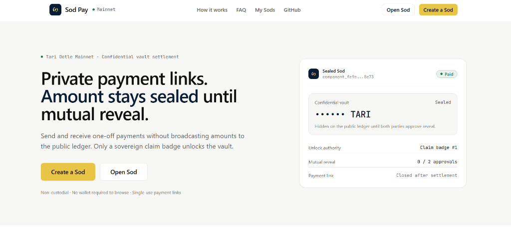
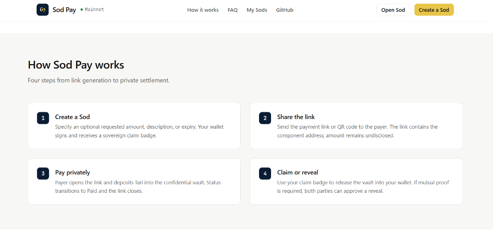
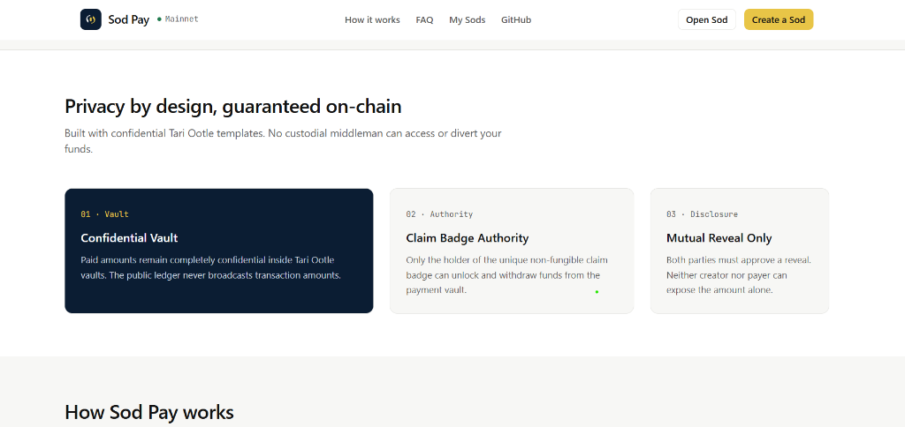
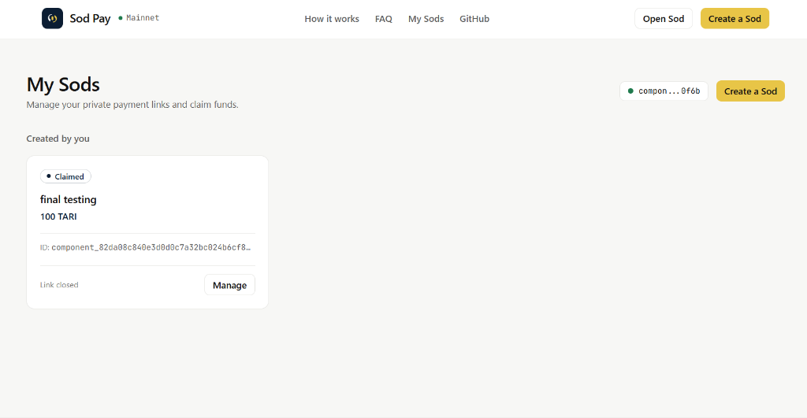

# Sod Pay

> Private payment links on Tari Ootle. The payment amount stays confidential until mutual reveal; only a claim badge unlocks funds.

---

## 1. Title & Overview

**Sod Pay** is a non-custodial Web3 payment link dapp built on Tari Ootle. Payment amounts are locked inside zero-knowledge confidential vaults, shielded from public block explorers. A unique sovereign non-fungible Claim Badge is minted directly to the creator, ensuring that only the rightful recipient can unlock funds. Should an amount need to be verified for accounting or audit, both creator and payer must mutually approve the reveal.

---

## 2. Links & Resources

- **Live Application:** [https://sod-pay.vercel.app](https://sod-pay.vercel.app)
- **GitHub Repository:** [https://github.com/Anekenonso/Sod-Pay](https://github.com/Anekenonso/Sod-Pay)
- **Deployed Mainnet Template:** [`template_f633483cd1d57317f6d9e104ecb2c5c1a37a8def33abf3784c15207d47fd3855`](https://indexer-a.ootle.tari.com/templates/f633483cd1d57317f6d9e104ecb2c5c1a37a8def33abf3784c15207d47fd3855)
- **Publish Transaction ID:** `b8e2d6619ecfc4e67149d71c4179504bdd8d5d3dbff44faae0ad81ff34e039a4`
- **Tari Template Source:** [`template/src/lib.rs`](template/src/lib.rs) (Tari Ootle WASM contract)
- **Announcement:** [Get Paid Without Broadcasting the Amount — Sod Pay on Tari Mainnet (Medium)](https://medium.com/@anekenonso/get-paid-without-broadcasting-the-amount-sod-pay-on-tari-mainnet-bd57653107a3)
- **Prize address:** `12Lz1AcdobKL9czd7fqkdQZTBAM8VWVdAnZP2Lk3aXmZbVFbffZGLM9Sh4QxGiXu3erstBeZPfFDaopRmof1fVFXS75`

---

## 3. The Idea in One Minute

Standard Web3 payments broadcast transaction amounts, wallet balances, and counterparty relationships to anyone watching the mempool or block explorer. Sod Pay solves this on Tari Ootle:

1. **Create a Sod:** Creator sets an optional expected amount and note. An on-chain `SodPay` component is instantiated, and a single non-fungible Claim Badge is minted to the creator.
2. **Share the Link:** Creator sends `/pay/<componentAddress>` or displays the QR code. The amount remains hidden from observers.
3. **Pay Privately:** The payer deposits Tari tokens directly into the component's confidential vault using an Ootle bucket. Status transitions to `Paid`.
4. **Claim with Badge:** Only the holder presenting the genuine Claim Badge can withdraw funds from the vault.
5. **Mutual Reveal:** Need proof of payment? Both parties must cryptographically sign to reveal the amount. Neither party can expose it alone.

---

## 4. Why Sod Pay

- **Confidential Commerce:** Freelancers, merchants, and OTC desks accept payments without leaking invoice values to competitors.
- **Badge-Gated Security:** Vault funds cannot be intercepted or diverted. Only the non-fungible Claim Badge unlocks the vault.
- **Fair Anti-Griefing Invariants:** Creators can cancel unfulfilled links at any time. Once funds are deposited (`Paid`), cancellation is permanently disabled.
- **Non-Custodial Design:** The app never holds private keys, seed phrases, or user funds. All operations execute directly on Tari Ootle.

---

## 5. How to Use Sod Pay

### 1. Open Sod Pay (No Wallet Required to Browse)
Visit [https://sod-pay.vercel.app](https://sod-pay.vercel.app). You can explore the workflow and FAQ without connecting a wallet—your wallet is only requested when you create, pay, claim, cancel, or reveal a Sod.



### 2. Create a Private Payment Link
Click **Create a Sod** (`/app/create`), connect your **Sapient** browser extension or local **`tari_ootle_walletd`**, and enter:
- **Description / Note** (required)
- **Amount (TARI)** — leave blank for an **open-amount** link, or set a fixed requested amount
- **Expires In (Epochs)** — optional network epoch duration

Submitting instantiates a `SodPay` component on Tari Ootle mainnet and mints a unique non-fungible **Claim Badge** directly to your wallet.



### 3. Share & Get Paid Privately
Send the `/pay/<componentAddress>` URL or QR code to your payer. The payer connects their wallet and deposits TARI into the component's confidential vault, transitioning the Sod from `Created` to `Paid`.



### 4. Manage, Claim, or Mutually Reveal in My Sods
Open **My Sods** (`/app`) to view links created or paid in your session—or paste any `component_...` address into the **Import Sod** bar to load it on-chain from another browser or device.
- **Claim:** Only the wallet holding the Claim Badge can withdraw funds from the vault (`Paid` → `Claimed`).
- **Cancel:** Creators can cancel unpaid links while in `Created` status.
- **Mutual Reveal:** Either creator or payer can call `request_reveal()`, and the other party can call `approve_reveal()` to unlock the contract's `Revealed` attestation state.



---

## 6. Product Tour

- `/` — **Homepage:** Project value propositions, interactive FAQ accordion, scroll reveal animations, and hero CTAs. No wallet connection prompt on visit.
- `/app` — **My Sods:** Creator dashboard listing authentic on-chain payment links with real-time status and badge ownership detection.
- `/app/create` — **Create a Sod:** Form to issue a new private payment link, minting the associated Claim Badge on-chain.
- `/app/s/[id]` — **Sod Detail:** Shareable links, QR code, on-chain claim triggers, cancellation, and mutual reveal approvals.
- `/pay/[id]` — **Pay Page:** Payer interface supporting fixed-amount verification or payer-chosen open amounts with bucket deposits.
- `/api/health` — **Health Check:** System health endpoint returning `{ ok: true }`.

---

## 6. How It Works

```
[Creator Wallet] ---> create() ---> [Sod Component] + [Claim Badge minted to Creator]
                                          |
[Payer Wallet]   ---> pay(Bucket)  ---> [Confidential Vault locked on-chain]
                                          |
[Creator Wallet] ---> claim(Badge) ---> [Funds transferred to Creator Vault]
                                          |
[Mutual Consent] ---> reveal()     ---> [Amount revealed publicly]
```

1. **Instantiation:** `create(amount, description, expiry)` deploys the component substate and mints an exclusive non-fungible Claim Badge to the creator.
2. **Deposit:** `pay(payment: Bucket)` withdraws funds from the payer's account into a workspace bucket and deposits them into the component's confidential vault.
3. **Claim:** `claim()` requires authorization via the Claim Badge (`rule!(resource(badge_resource))`), withdrawing all vault funds to the claimant.
4. **Mutual Reveal:** `request_reveal()` and `approve_reveal()` require approvals from two distinct participating parties (creator and payer).

---

## 7. Verification & Invariants

The protocol guarantees 5 cryptographic invariants in both the Rust smart contract (`template/src/lib.rs`) and client verification:

1. **Claim Badge Exclusivity:** Vault redemption requires proof of the specific non-fungible badge resource.
2. **Mutual Reveal Requirement:** Amount remains confidential until two distinct cryptographic parties approve.
3. **Cancellation Rule:** Cancel succeeds only from `Created` status by the original creator. Calling `cancel` after `pay` aborts immediately.
4. **Amount Enforcement:** Fixed-amount Sods reject mismatched deposits with clear error diagnostics.
5. **Expiry Protection:** Expired Sods reject new deposits on-chain (`Consensus::current_epoch() <= expiry`). Unpaid Sods can be cancelled by the creator.

---

## 8. Network & Execution

Sod Pay operates directly on Tari Ootle mainnet (`mode: "REAL"`):

- **Tari Indexer:** Connects via `@tari-project/ootle-indexer` to read substates and verify transaction receipts.
- **Wallet Signer:** Supports native browser extensions (**Sapient**) and local wallet daemons (**`tari_ootle_walletd`**) via `@tari-project/ootle-wallet-daemon-signer`.
- **Zero Simulation:** Every creation, deposit, claim, cancellation, and reveal executes real, verifiable on-chain transactions.

---

## 9. At a Glance

| Component | Technology | Detail |
| :--- | :--- | :--- |
| **Frontend Framework** | Next.js 15 (App Router) | React 19, Tailwind CSS, TypeScript |
| **Package Manager** | pnpm | Pinned dependencies |
| **Smart Contract** | Rust `#[template]` | `tari_template_lib` targeting Tari Ootle engine |
| **Network** | Tari Ootle Mainnet | Live on-chain execution (`mode: "REAL"`) |
| **Privacy Model** | Confidential Vault | Amounts shielded until mutual reveal |
| **Access Control** | Non-Fungible Badge | Sovereign authority minted directly to creator |
| **Cancellation** | Creator Pre-payment | Restricted strictly to `Created` status |
| **Signer Support** | Sapient & Wallet Daemon | EVM-style extension or JSON-RPC daemon |

---

## 10. Quickstart

### Prerequisites

- Node.js 20+ and `pnpm`
- Rust 1.80+ with `wasm32-unknown-unknown` target (for template builds)
- Tari Wallet: [Sapient Browser Extension](https://ootle.tari.com/guides/setup-a-wallet/) or `tari_ootle_walletd`

### Frontend Setup

```bash
# Install dependencies
pnpm install

# Run test suite
pnpm test

# Build production bundle
pnpm build

# Start local development server
pnpm dev
```

### Smart Contract Tests

```bash
cd template

# Run the 5 on-chain domain tests
cargo test
```

---

## 11. Repository Layout

```
.
├── app/                  # Next.js 15 App Router pages, layouts, and API routes
│   ├── api/health/       # System health route
│   ├── app/              # Dashboard & Create flows
│   ├── pay/[id]/         # Payer payment view
│   ├── icon.svg          # Favicon branding
│   ├── icon.tsx          # Dynamic metadata icon generator
│   └── page.tsx          # Homepage with FAQ accordion and scroll reveals
├── components/           # UI and domain components (Tailwind CSS)
│   ├── home/             # Homepage FAQ accordion & scroll reveal helpers
│   ├── layout/           # Navbar, Footer, MobileMenu
│   ├── sod/              # CreateForm, SodCard, SharePanel
│   ├── ui/               # Badge, Button, Input, Logo, Toast
│   └── wallet/           # WalletContext, ConnectPrompt, ConnectButton
├── lib/                  # Protocol libraries and SDK adapters
│   ├── tari/             # Real Tari client, finality polling, wallet connectors
│   ├── constants.ts      # Routes, design tokens, microcopy, config
│   └── sod.ts            # Domain types and invariant state guards
├── template/             # Tari Ootle Rust template
│   ├── src/lib.rs        # Contract logic and unit test suite
│   └── Cargo.toml        # tari_template_lib dependency
├── test/                 # Vitest test suites
└── docs/                 # Specifications and task tracking
```

---

## 12. Security & Risks

- **Non-Custodial Architecture:** Sod Pay never handles, persists, or transmits user private keys.
- **Client Signer Security:** Signing is delegated exclusively to the local Tari Wallet Daemon or Sapient browser extension.
- **On-Chain Enforcement:** Invariants (access control, mutual reveal, cancellation rules) are enforced by the Tari DAN engine at the consensus level, not solely in client-side code.
- **Substate Verification:** Substates and component addresses are resolved through the Tari Indexer.

---

## 13. License

This project is licensed under the [MIT License](LICENSE).
